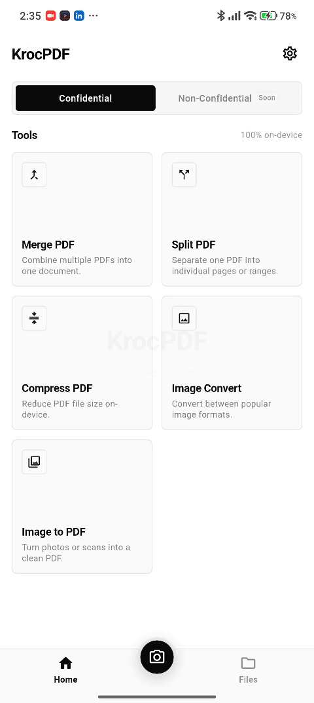

# KrocPDF

[](https://github.com/KrocPDF/App/actions/workflows/pr-checks.yml)
[](https://github.com/KrocPDF/App/actions/workflows/release-checks.yml)
[](https://flutter.dev)
[](https://dart.dev)
[](#platform-status)
[](LICENSE)

An all-in-one, privacy-first file converter and PDF toolkit built with Flutter.

---

## Visual Tour

| Branded Cold-Start Launch | Monochrome Tool Grid (Confidential Mode) |
| :---: | :---: |
|  |  |
| *On-device cold-start sequence* | *100% local processing up to 100 MB* |

---

## Toolchain & Versions (Pinned)

- **Flutter SDK:** `3.44.6` (channel stable, revision `ee80f08bbf`)
- **Dart SDK:** `3.12.2`
- **Application ID / Bundle ID:** `com.krocpdf.app`

---

## Platform Status

- **Android:** Verified. `minSdkVersion = 24`, `targetSdkVersion = 35`. Release builds require zero runtime permissions. Debug builds include `android.permission.INTERNET` solely for Flutter tooling/debugging.
- **iOS:** Configured. Deployment target `13.0`, bundle identifier `com.krocpdf.app`. Note: iOS is unbuilt and unverified in Phase 1 and will be validated on a macOS host using this repository in a later phase.

---

## Setup & Running Locally

### Prerequisites
Ensure Flutter `3.44.6` and Dart `3.12.2` are installed and available on your PATH:
```bash
flutter --version
```

### 1. Install Dependencies
Dependencies are strictly pinned in `pubspec.yaml`:
```bash
flutter pub get
```

### 2. Enable Local Pre-Commit Hooks
Keep your commits aligned with CI formatting and static analysis rules:
```bash
git config core.hooksPath .githooks
```

### 3. Run Static Analysis
Ensure zero issues:
```bash
flutter analyze
```

### 4. Run Tests
Execute the automated test suite:
```bash
flutter test
```

### 5. Run the Application
Launch on a connected Android device or emulator:
```bash
flutter run
```

### 6. Re-generating Native Splash Screen
If the logo image or splash background colors are modified, update `flutter_native_splash.yaml` and regenerate the native Android & iOS splash assets:
```bash
dart run flutter_native_splash:create
```

---

## Architectural Guidelines & Governance

- **Decisions:** All architectural decisions are documented in [`docs/DECISIONS.md`](docs/DECISIONS.md). Every change is tracked using sequential ADRs.
- **Architecture:** Complete structure, navigation, and service interfaces are documented in [`docs/ARCHITECTURE.md`](docs/ARCHITECTURE.md).
- **Contributing:** Please read [`CONTRIBUTING.md`](CONTRIBUTING.md) and [`CODE_OF_CONDUCT.md`](CODE_OF_CONDUCT.md) before opening a PR.
- **Security:** Report vulnerabilities privately via [`SECURITY.md`](SECURITY.md).
- **Changelog:** Tracked in [`CHANGELOG.md`](CHANGELOG.md).
- **License:** Released under the [MIT License](LICENSE).
