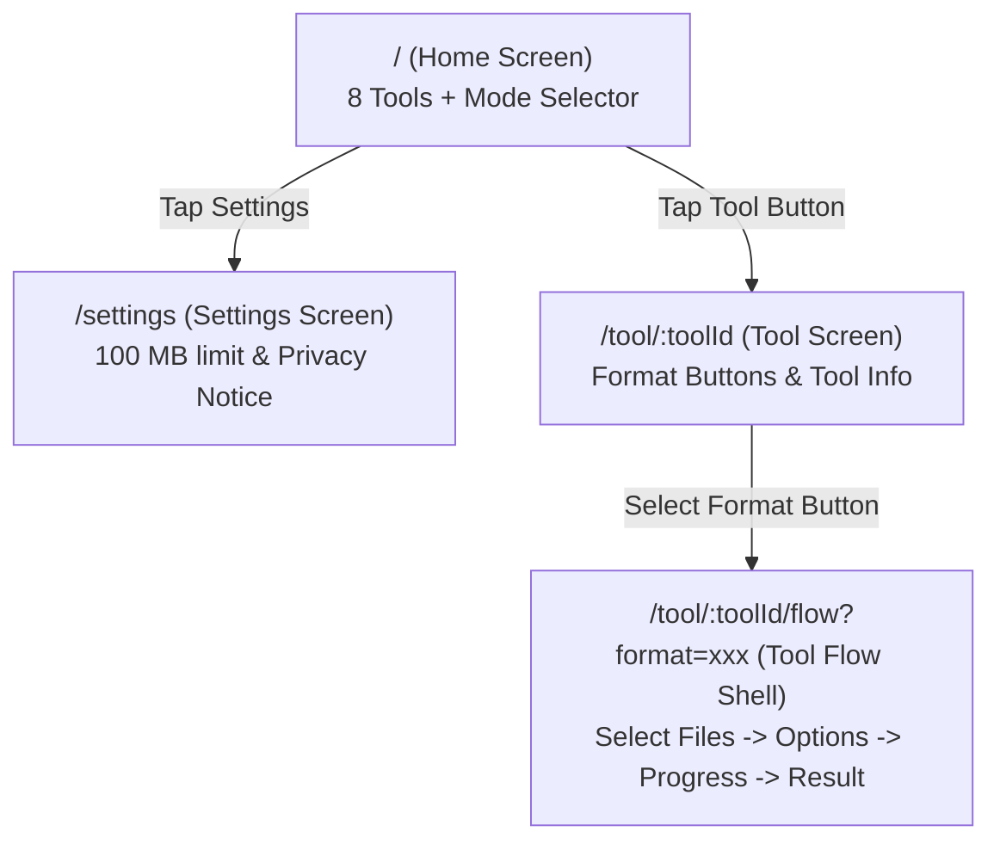
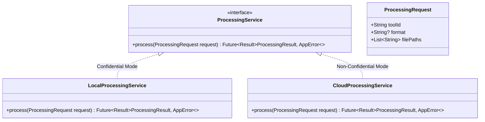

# KrocPDF Architecture Specification

## 1. Overview
KrocPDF is an all-in-one file converter and PDF toolkit designed with a privacy-first architecture. It operates primarily in **Confidential Mode** (100% on-device processing) with planned support for **Non-Confidential Mode** (cloud-assisted processing for heavy formats such as Office document conversion).

---

## 2. Pinned Toolchain & Environment
- **Flutter SDK:** `3.44.6` (channel stable, revision `ee80f08bbf`)
- **Dart SDK:** `3.12.2`
- **Android Target:** `minSdk = 24`, `targetSdk = 35` (Verified)
- **iOS Target:** Deployment target `13.0`, bundle ID `com.krocpdf.app` (*Fully configured, but unbuilt/unverified in Phase 1 — verification will occur on a macOS host in a later phase*)

---

## 3. Directory Structure (Feature-First)

```
lib/
├── app.dart                                # MaterialApp.router configuration, global theme, and top-level providers
├── main.dart                               # Application entrypoint with ProviderScope
├── core/
│   ├── constants/
│   │   └── app_limits.dart                 # Single source of truth (AppLimits.maxLocalFileBytes = 100 MB)
│   ├── errors/
│   │   └── app_error.dart                  # Sealed domain errors (FileTooLarge, UnsupportedType, etc.)
│   ├── result/
│   │   └── result.dart                     # Functional Result<T, E> model for safe returns
│   └── theme/
│       └── app_theme.dart                  # Strict monochrome theme (Light #FFFFFF/#E5E5E5, Dark #000000/#2A2A2A)
├── features/
│   ├── home/
│   │   └── presentation/
│   │       ├── home_screen.dart            # Grid of 8 tool buttons + Mode selector + Settings navigation
│   │       └── widgets/
│   │           ├── mode_selector.dart      # Confidential (active) vs Non-Confidential (coming soon)
│   │           └── tool_grid_item.dart     # Flat 1px bordered tool tile
│   ├── settings/
│   │   └── presentation/
│   │       └── settings_screen.dart        # 100 MB limit display, privacy notice, version info
│   └── tool_flow/
│       └── presentation/
│           ├── tool_flow_screen.dart       # 4-stage UI shell (Select, Options, Progress, Result)
│           └── widgets/
│               ├── format_selector.dart    # Format buttons (JPG/PNG/HEIC/WEBP, Word/Excel/PPT, PDF)
│               └── step_placeholder.dart  # "Processing not implemented yet" placeholder
└── services/
    ├── file_validation_service.dart        # Validates file size against AppLimits.maxLocalFileBytes
    └── processing/
        ├── processing_service.dart         # Abstract interface for tool operations
        ├── local_processing_service.dart   # On-device implementation stub (throws UnimplementedError)
        └── cloud_processing_service.dart   # Remote cloud implementation stub (throws UnimplementedError)
```

---

## 4. Navigation Flow (`go_router`)

All navigation is declarative. Format selections are passed via query parameters:



### Route Definitions:
- `/` — Home screen with 8 tool buttons and the mode selector.
- `/settings` — Settings screen displaying file limits and privacy policy.
- `/tool/:toolId` — Tool format selector screen (presents format buttons: e.g. JPG, PNG, HEIC, WEBP for image conversion; Word, Excel, PowerPoint for Office; PDF for PDF tools).
- `/tool/:toolId/flow?format=:format` — 4-stage tool execution flow placeholder with format parameter passed via query string.

---

## 5. Processing Service Interface & Pluggability

The core architecture decouples user interface workflows from processing engines using the `ProcessingService` interface.



### Dependency Injection via Riverpod:
A Riverpod provider resolves the appropriate `ProcessingService` based on the active mode (`AppMode.confidential` vs `AppMode.nonConfidential`):

```dart
final processingServiceProvider = Provider<ProcessingService>((ref) {
  final mode = ref.watch(appModeProvider);
  switch (mode) {
    case AppMode.confidential:
      return ref.watch(localProcessingServiceProvider);
    case AppMode.nonConfidential:
      return ref.watch(cloudProcessingServiceProvider);
  }
});
```

In Phase 1, both `LocalProcessingService` and `CloudProcessingService` stub out methods and throw `UnimplementedError` or return placeholder results. In Phase 2 and Phase 4, native on-device engines and remote cloud APIs will be injected respectively without modifying any presentation code.
